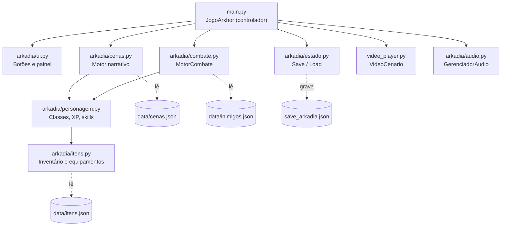
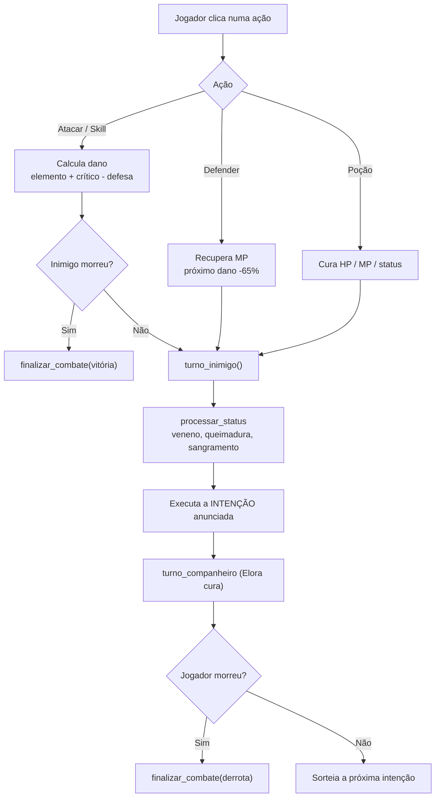
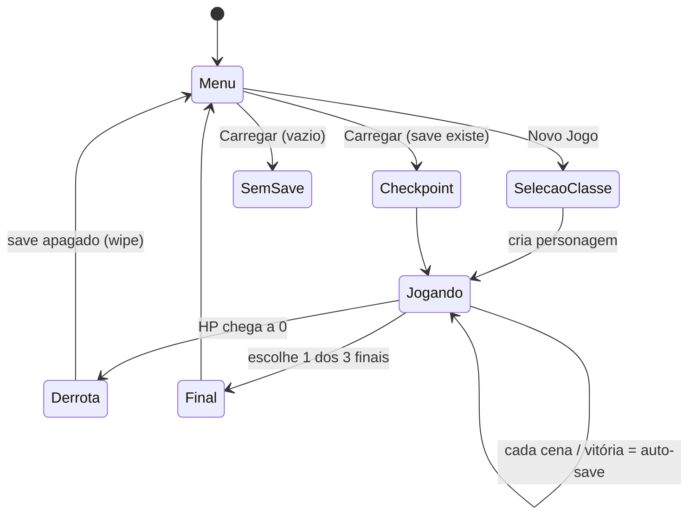

# As Crônicas de Arkhor: o código explicado em blocos

> Material de apoio para apresentar o trabalho de **Paradigmas em Python**.
> Versão analisada: commit `399ded2` (v1.0), na pasta `EXERCICIOS\Jogo RPG`.

---

## Bloco 0: visão geral (comece por aqui)

**O que é:** um RPG narrativo com interface gráfica. Cada tela mostra um **vídeo de cenário** em cima e, embaixo, a **história e os botões de escolha**. Tem combate por turnos, inventário, missões, uma companheira (Elora), três finais diferentes e save automático.

**Tecnologias:**
| Biblioteca | Para que serve |
|---|---|
| `pygame` | Janela, desenho, fontes, mouse e áudio |
| `av` (PyAV/FFmpeg) | Decodificar os vídeos `.mp4` dos cenários |
| `json` (nativa) | Guardar o conteúdo do jogo e o save |
| `PyInstaller` | Gerar o `.exe` para Windows |

**Ideia principal da arquitetura: separar o código dos dados.**
O código Python é o **motor**. A história, os inimigos e os itens ficam em arquivos **JSON**. Para criar uma cena nova não precisa programar nada: basta editar o JSON.



**Paradigmas usados (o tema da disciplina):**
| Paradigma | Onde aparece |
|---|---|
| **Orientação a Objetos** | Classes `JogoArkhor`, `MotorCombate`, `Botao`, `VideoCenario`, `GerenciadorCenarios`, `GerenciadorAudio` |
| **Procedural / estruturado** | Módulos de funções puras: `personagem.py`, `itens.py`, `cenas.py`, `estado.py` |
| **Funcional** | `lambda`, *closures*, *callbacks*, *list comprehensions*, funções como valores |
| **Orientado a eventos** | O loop do pygame reage a cliques (`MOUSEBUTTONDOWN`) |
| **Orientado a dados** | Toda a história e o balanceamento ficam em JSON |

---

## Bloco 1: estrutura de pastas

```
Jogo RPG/
├── main.py              ← ponto de entrada + classe JogoArkhor
├── video_player.py      ← classe VideoCenario (vídeo em loop)
├── arkadia/             ← pacote com a lógica do jogo
│   ├── __init__.py      ← marca a pasta como pacote (versão 1.0.0)
│   ├── ui.py            ← interface: Botao, barras, painel
│   ├── cenas.py         ← motor narrativo (lê cenas.json)
│   ├── combate.py       ← MotorCombate (combate por turnos)
│   ├── personagem.py    ← criação, XP, níveis e skills
│   ├── itens.py         ← inventário e equipamentos
│   ├── estado.py        ← save, load, migração e permadeath
│   └── audio.py         ← músicas e efeitos sonoros
├── data/                ← CONTEÚDO do jogo (sem código)
│   ├── cenas.json       ← história, escolhas e efeitos
│   ├── inimigos.json    ← status, ataques e fases dos chefes
│   ├── itens.json       ← armas, armaduras e poções
│   └── missoes.json     ← missões
├── assets/              ← vídeos .mp4 dos cenários
├── save_arkadia.json    ← progresso do jogador
├── test_verificacao.py  ← testes automatizados
└── terminal_rpg.py      ← versão original, só em texto
```

> **Como falar:** "Separamos em **pacote** (`arkadia/`), **dados** (`data/`) e **mídia** (`assets/`). Cada módulo tem uma única responsabilidade."

---

## Bloco 2: o ponto de entrada e as constantes ([main.py](file:///F:/PEDRO/Estudos/ESTÁCIO/SEGUNDO%20PERIODO/PARADIGMAS%20EM%20PYTHON/EXERCICIOS/Jogo%20RPG/main.py))

```python
LARGURA = 960
ALTURA = 640
ALTURA_CENARIO = 380        # 380px de vídeo em cima, o resto é o painel

if getattr(sys, 'frozen', False):          # Está rodando como .exe?
    DIRETORIO_BASE = os.path.dirname(sys.executable)
else:                                       # Ou como script .py?
    DIRETORIO_BASE = os.path.dirname(os.path.abspath(__file__))

ARQUIVO_SAVE = os.path.join(DIRETORIO_BASE, "save_arkadia.json")
PASTA_ASSETS = os.path.join(DIRETORIO_BASE, "assets")
```

**O que explicar:**
- **Constantes em MAIÚSCULAS** guardam o tamanho da tela. Para mudar o layout, mexe-se num lugar só.
- O `if getattr(sys, 'frozen', False)` descobre se o jogo roda como `.exe` (PyInstaller) ou como `python main.py`. Isso faz os caminhos funcionarem nos dois casos.
- `os.path.join` monta caminhos que funcionam em qualquer sistema operacional.

No final do arquivo fica o **ponto de entrada**:
```python
if __name__ == "__main__":
    app = JogoArkhor()   # cria o objeto do jogo
    app.executar()       # inicia o loop principal
```
> `if __name__ == "__main__"` faz o jogo iniciar **só** quando o arquivo é executado direto, e não quando outro arquivo o importa (como os testes).

---

## Bloco 3: classe `GerenciadorCenarios` (carregar vídeos e imagens)

Está em [main.py](file:///F:/PEDRO/Estudos/ESTÁCIO/SEGUNDO%20PERIODO/PARADIGMAS%20EM%20PYTHON/EXERCICIOS/Jogo%20RPG/main.py#L34-L117) e decide **o que desenhar no fundo** de cada cena.

```python
class GerenciadorCenarios:
    EXTENSOES_VIDEO = (".mp4", ".avi", ".mov", ".mkv", ".webm")   # atributo de classe
    EXTENSOES_IMAGEM = (".png", ".jpg", ".jpeg", ".bmp", ".webp")

    def __init__(self, largura, altura):
        self.texturas = {}   # cache de imagens
        self.videos = {}     # cache de vídeos
```

**Lógica de `obter_cenario()` em 3 tentativas (*fallback*):**
1. Já está no **cache** (dicionário)? Devolve na hora, sem recarregar.
2. Existe **vídeo**? Cria um `VideoCenario`.
3. Existe **imagem**? Carrega com `pygame.image.load`.
4. Se nada existir, **desenha uma grade procedural** com o nome do cenário. Assim o jogo nunca trava por falta de arquivo.

```python
for x in range(0, self.largura, 40):       # laço: linhas verticais a cada 40px
    pygame.draw.line(superficie_padrao, (42, 45, 58), (x, 0), (x, self.altura))
for y in range(0, self.altura, 40):        # laço: linhas horizontais
    pygame.draw.line(superficie_padrao, (42, 45, 58), (0, y), (self.largura, y))
```

**Conceitos:** cache com dicionário, **polimorfismo** em `renderizar()` (usa `isinstance` para tratar vídeo e imagem de jeitos diferentes) e tolerância a falhas.

---

## Bloco 4: classe `VideoCenario` (vídeo em loop) ([video_player.py](file:///F:/PEDRO/Estudos/ESTÁCIO/SEGUNDO%20PERIODO/PARADIGMAS%20EM%20PYTHON/EXERCICIOS/Jogo%20RPG/video_player.py))

```python
def _proximo_frame(self):
    try:
        frame = next(self.gerador_frames)          # pega o próximo quadro
    except (StopIteration, av.FFmpegError, EOFError):
        self.container.seek(0)                     # acabou? volta ao início
        self.gerador_frames = self.container.decode(self.stream)
        frame = next(self.gerador_frames)

    frame_redimensionado = frame.reformat(width=self.largura, height=self.altura, format="rgb24")
    rgb_frame = frame_redimensionado.to_ndarray()
    self.surface_atual = pygame.surfarray.make_surface(rgb_frame.swapaxes(0, 1))
```

**O que explicar:**
- `container.decode()` devolve um **gerador** (*iterator*). `next()` pega um quadro por vez, sem carregar o vídeo inteiro na memória.
- Quando o vídeo termina, o Python lança `StopIteration`. O `except` captura e faz `seek(0)`, criando o **loop infinito**.
- O FFmpeg redimensiona o quadro, que vira um array NumPy e depois uma *Surface* do pygame.
- **Controle de FPS:** em `atualizar_e_desenhar()`, `time.perf_counter()` mede o tempo e o quadro só avança quando passa `1/fps` segundos. Assim o vídeo roda na velocidade certa mesmo com o jogo a 60 FPS.
- O `_` no começo de `_carregar` e `_proximo_frame` indica **método interno** (encapsulamento por convenção).

---

## Bloco 5: classe `JogoArkhor`, o controlador central ([main.py](file:///F:/PEDRO/Estudos/ESTÁCIO/SEGUNDO%20PERIODO/PARADIGMAS%20EM%20PYTHON/EXERCICIOS/Jogo%20RPG/main.py#L123-L388))

Ela **coordena** os outros módulos. Funciona como o "maestro" do jogo.

### 5.1 Construtor `__init__`
```python
def __init__(self):
    pygame.init()
    self.tela = pygame.display.set_mode((LARGURA, ALTURA))
    self.fontes = {"titulo": ..., "titulo_pequeno": ..., "texto": ..., "ui": ..., "ui_pequena": ...}
    self.cenarios = GerenciadorCenarios(LARGURA, ALTURA_CENARIO)   # composição
    self.audio = GerenciadorAudio(PASTA_ASSETS)                     # composição
    self.jogador = None          # ainda não existe personagem
    self.motor_combate = None    # ainda não há combate
    self.ir_para_cena("menu_principal")
```
> **Composição:** `JogoArkhor` **tem um** `GerenciadorCenarios` e **tem um** `GerenciadorAudio`. Ele não herda deles.

### 5.2 `ir_para_cena(cena_id)`: a navegação
Todo clique em botão de história chama este método. Ele segue 5 passos:
1. Busca a cena no JSON (`obter_cena`).
2. Atualiza o cenário, o título e as linhas de texto.
3. Aplica os **efeitos** da cena (XP, ouro, itens, flags).
4. Faz o **auto-save** (checkpoint).
5. Se a cena tem `combate_inimigo`, **inicia o combate**. Se não, **monta os botões**.

### 5.3 `montar_botoes_cena(opcoes)`: botões dinâmicos
```python
for op in opcoes:
    habilitado = verificar_requisito_opcao(op, self.jogador)   # tem o item/ouro/flag?
    callback = self._criar_callback_opcao(op)                  # o que faz ao clicar
    opcoes_validas.append((op["texto"], callback, habilitado))

y_inicial = max(ALTURA_CENARIO + 44, ALTURA - 16 - (qtd * (altura_btn + espacamento)))
```
- Os botões são **empilhados de baixo para cima**. O `max()` impede que subam por cima da barra de status.
- Se a opção exigir algo que o jogador não tem, o botão aparece **cinza e desabilitado**.

### 5.4 `_criar_callback_opcao(opcao)`: funções como valores
```python
if "ir_para" in opcao:
    destino = opcao["ir_para"]
    return lambda: self.ir_para_cena(destino)     # devolve uma FUNÇÃO
...
elif acao == "escolher_mago":
    return lambda: self.confirmar_classe("Mago")
```
> **Paradigma funcional:** o método **devolve uma função** (`lambda`), que o botão guarda para executar só quando for clicado. A `lambda` "lembra" o valor de `destino`: isso se chama **closure**.

### 5.5 `atualizar_interface_combate()`: grade tática
- Os botões de **ataque e skills** ficam em coluna, com largura total.
- **Defesa e poções** ficam numa **grade 2x2**, calculada com divisão inteira e resto:
```python
for idx, (label, cb, hab) in enumerate(acoes_grade):
    lin = idx // 2        # linha: 0,0,1,1
    col = idx % 2         # coluna: 0,1,0,1
    rx = x_base + col * (larg_col + esp_x)
    ry = y_grade_topo + lin * (alt_col + esp_y)
```
- Cada ação é "embrulhada" por uma função que **atualiza a tela depois da jogada** (*decorator* manual com closure):
```python
def criar_wrapper(fn):
    def acao_wrapper():
        fn()                                   # executa a ação (ex.: atacar)
        if self.motor_combate:
            self.atualizar_interface_combate() # redesenha os botões
    return acao_wrapper
```

### 5.6 Vitória e derrota
- `vitoria_combate()` salva o jogo e mostra XP, ouro e itens saqueados.
- `derrota_combate()` aplica o **permadeath**: apaga o save (`wipe_save`) e volta para a cena `"derrota"`.

### 5.7 O **loop principal** `executar()` (o coração do jogo)
```python
def executar(self):
    while True:                                   # 1 volta = 1 quadro
        mouse_pos = pygame.mouse.get_pos()

        for evento in pygame.event.get():         # (1) LER EVENTOS
            if evento.type == pygame.QUIT:
                self.encerrar_jogo()
            for botao in list(self.botoes):
                if botao.lidar_evento(evento):
                    break

        self.cenarios.renderizar(self.cenario_atual, self.tela)   # (2) DESENHAR FUNDO
        desenhar_painel_narrativo(...)                            # (3) DESENHAR PAINEL

        pygame.display.flip()                     # (4) MOSTRAR NA TELA
        self.clock.tick(60)                       # (5) LIMITAR A 60 FPS
```
> **Como falar:** "Todo jogo tem um *game loop*: **ler entrada, atualizar, desenhar**. O `while True` repete isso 60 vezes por segundo."
>
> Detalhe: `list(self.botoes)` faz uma **cópia** da lista. Isso é necessário porque um clique pode trocar de cena e recriar os botões enquanto o laço ainda percorre a lista.

---

## Bloco 6: interface gráfica ([arkadia/ui.py](file:///F:/PEDRO/Estudos/ESTÁCIO/SEGUNDO%20PERIODO/PARADIGMAS%20EM%20PYTHON/EXERCICIOS/Jogo%20RPG/arkadia/ui.py))

### 6.1 Paleta de cores
Constantes com tuplas RGB no topo (`COR_VIDA = (210, 50, 50)`). Isso deixa o visual padronizado e fácil de mudar.

### 6.2 Função `quebrar_texto()`: quebra de linha automática
```python
def quebrar_texto(texto, fonte, largura_maxima):
    palavras = texto.split(" ")
    linhas_quebradas, linha_atual = [], []
    for palavra in palavras:
        teste = " ".join(linha_atual + [palavra])
        if fonte.size(teste)[0] <= largura_maxima:   # ainda cabe?
            linha_atual.append(palavra)
        else:                                          # não cabe: fecha a linha
            linhas_quebradas.append(" ".join(linha_atual))
            linha_atual = [palavra]
    if linha_atual:
        linhas_quebradas.append(" ".join(linha_atual))
    return linhas_quebradas
```
> **Algoritmo guloso:** coloca palavras na linha enquanto couberem em pixels. Quando não cabe mais, começa uma linha nova. É isso que impede o texto de vazar da caixa.

### 6.3 Classe `Botao`
| Método | Função |
|---|---|
| `__init__` | Guarda o retângulo, o texto, o **callback** e se está habilitado |
| `desenhar()` | Pinta o botão. Muda de cor no *hover*. Se o texto não couber: **1)** tenta a fonte normal, **2)** usa uma fonte menor, **3)** quebra em 2 linhas |
| `lidar_evento()` | Se houve clique esquerdo dentro do retângulo, executa `self.callback()` |

> O botão **não sabe** o que faz: ele só chama a função que recebeu. Isso é **baixo acoplamento**, e por isso a mesma classe serve para "Novo Jogo", "Atacar" ou "Comprar Poção".

### 6.4 `desenhar_barra()` e `desenhar_painel_narrativo()`
- A barra de HP/MP calcula a proporção com `max(0.0, min(1.0, atual / max(1, maximo)))`. Isso **limita** o valor entre 0 e 1 e evita divisão por zero.
- O painel narrativo desenha, em ordem: status do jogador (posição X **dinâmica**, sem sobrepor texto), título (fonte adaptativa), vida e intenção do inimigo, texto com quebra de linha e botões.

---

## Bloco 7: personagem, XP e habilidades ([arkadia/personagem.py](file:///F:/PEDRO/Estudos/ESTÁCIO/SEGUNDO%20PERIODO/PARADIGMAS%20EM%20PYTHON/EXERCICIOS/Jogo%20RPG/arkadia/personagem.py))

### 7.1 `TABELA_SKILLS`: dicionário de listas de dicionários
```python
TABELA_SKILLS = {
    "Guerreiro": [ {"nome": "Golpe Brutal", "nivel_req": 1, "custo_mp": 10, ...}, ... ],
    "Mago":      [ {"nome": "Bola de Fogo", "nivel_req": 1, "elemento": "fogo", ...}, ... ],
    "Arqueiro":  [ ... ]
}
```
Cada classe tem 3 habilidades, desbloqueadas nos níveis 1, 2 e 3.

### 7.2 `criar_personagem(nome, classe)`
Escolhe os atributos da classe (Guerreiro: mais vida; Mago: mais mana; Arqueiro: equilibrado) e devolve um **dicionário** com tudo: vida, mana, ouro, inventário, flags, missões e checkpoint.
> **Decisão de projeto:** o jogador é um **dicionário**, não um objeto. Assim ele vira JSON direto na hora de salvar (`json.dump`), sem conversão.

### 7.3 `obter_skills_disponiveis()`: *list comprehension*
```python
return [s for s in skills if s["nivel_req"] <= nivel]
```
> Filtra numa linha só as skills que o nível atual já liberou.

### 7.4 `ganhar_xp()`: laço `while` para subir vários níveis de uma vez
```python
while jogador["xp"] >= jogador["xp_proximo"]:
    jogador["xp"] -= jogador["xp_proximo"]
    jogador["nivel"] += 1
    jogador["xp_proximo"] = int(jogador["xp_proximo"] * 1.35)   # curva de dificuldade
    jogador["vida_max"] += 15
    ...
```
> Usamos `while` e não `if` porque um ganho grande de XP pode render **mais de um nível**. A meta cresce 35% a cada nível (progressão exponencial).

---

## Bloco 8: itens, inventário e equipamentos ([arkadia/itens.py](file:///F:/PEDRO/Estudos/ESTÁCIO/SEGUNDO%20PERIODO/PARADIGMAS%20EM%20PYTHON/EXERCICIOS/Jogo%20RPG/arkadia/itens.py))

### 8.1 Cache do catálogo (padrão *lazy loading*)
```python
_ITENS_CACHE = None

def carregar_catalogo_itens():
    global _ITENS_CACHE
    if _ITENS_CACHE is None:                       # só lê o arquivo 1 vez
        with open(ARQUIVO_ITENS, "r", encoding="utf-8") as f:
            _ITENS_CACHE = json.load(f)
    return _ITENS_CACHE
```
> O JSON é lido **apenas na primeira vez**. As outras chamadas usam a cópia em memória. O mesmo padrão se repete em `cenas.py` e `combate.py`.

### 8.2 Funções principais
| Função | O que faz |
|---|---|
| `obter_item(id)` | Busca o item no catálogo. Se não existir, devolve um item "desconhecido" (`dict.get` com valor padrão) |
| `adicionar_ao_inventario()` | Limite de **16 espaços** (itens de missão e materiais não contam). **Equipa automaticamente** armas e armaduras melhores que as atuais |
| `remover_do_inventario()` | Remove N unidades com laço `for` e `break` |
| `equipar_item()` | Troca o equipamento, devolve o antigo ao inventário e recalcula os atributos |
| `recalcular_atributos()` | **Ataque = base + arma**, **Defesa = base + armadura**, **Mana máx = base + bônus** |
| `usar_consumivel()` | Aplica cura de HP, MP ou status conforme o JSON |

> Os atributos "base" ficam separados dos bônus. Assim, trocar de arma nunca "perde" pontos ganhos por nível.

---

## Bloco 9: motor narrativo ([arkadia/cenas.py](file:///F:/PEDRO/Estudos/ESTÁCIO/SEGUNDO%20PERIODO/PARADIGMAS%20EM%20PYTHON/EXERCICIOS/Jogo%20RPG/arkadia/cenas.py) + [data/cenas.json](file:///F:/PEDRO/Estudos/ESTÁCIO/SEGUNDO%20PERIODO/PARADIGMAS%20EM%20PYTHON/EXERCICIOS/Jogo%20RPG/data/cenas.json))

### 9.1 Formato de uma cena no JSON
```json
"ajudar_vila": {
  "cenario": "vila.mp4",
  "titulo": "VILA LÚMEN — RELATO",
  "linhas": ["A mulher entrega uma lâmina antiga...", "..."],
  "efeitos": [
    {"set_flag": "ajudou_vila", "valor": true},
    {"add_item": "espada_quebrada"},
    {"add_xp": 30},
    {"add_reputacao": 15}
  ],
  "opcoes": [
    {"texto": "Acessar o Povoado de Lúmen (Hub)", "ir_para": "hub_vila"}
  ]
}
```
> **O jogo é um grafo:** cada cena é um **nó** e cada `ir_para` é uma **aresta** que leva a outra cena.

### 9.2 `verificar_requisito_opcao()`: condições
Confere se a opção exige `requer_flag`, `bloqueia_flag`, `requer_ouro`, `requer_reputacao` ou `requer_item`. Devolve `True` ou `False` e, com isso, define se o botão fica ativo.
> Exemplo: "Câmara Secreta de Aurelion" só abre com o **Pergaminho**, e "Exibir a Runa Real" exige **20 de reputação**.

### 9.3 `executar_efeitos_cena()`: interpretador de efeitos
```python
for ef in cena["efeitos"]:
    if "set_flag" in ef:      flags[ef["set_flag"]] = ef.get("valor", True)
    if "add_ouro" in ef:      jogador["ouro"] = max(0, jogador["ouro"] + ef["add_ouro"])
    if "add_xp" in ef:        mensagens.extend(ganhar_xp(jogador, ef["add_xp"]))
    if "add_item" in ef:      adicionar_ao_inventario(jogador, ef["add_item"], 1)
    if "curar_tudo" in ef:    jogador["vida"] = jogador["vida_max"]; ...
    ...
```
> Funciona como um **mini-interpretador**: o laço lê cada "comando" do JSON e o executa.

**Proteção contra recompensa duplicada:**
```python
CENAS_REPETIVEIS = {"fogueira_descanso", "comprar_pocao_vida", ...}   # um set

visitadas = jogador.setdefault("cenas_recompensadas", [])
if cena_id and cena_id not in CENAS_REPETIVEIS:
    if cena_id in visitadas:
        return []          # já ganhou essa recompensa
    visitadas.append(cena_id)
```
> Sem isso, voltar a uma cena daria XP e itens de novo. Lojas e a fogueira ficam no `set` de cenas repetíveis.

---

## Bloco 10: combate por turnos ([arkadia/combate.py](file:///F:/PEDRO/Estudos/ESTÁCIO/SEGUNDO%20PERIODO/PARADIGMAS%20EM%20PYTHON/EXERCICIOS/Jogo%20RPG/arkadia/combate.py))

### 10.1 Classe `MotorCombate`
Cada combate cria **um objeto novo**, que guarda o estado da luta: inimigo, turno, *buffs* e log.
```python
def __init__(self, jogador, inimigo_id, cenario, vitoria_callback, derrota_callback):
    nivel = jogador.get("nivel", 1)
    self.inimigo = {
        "vida_max": dados_base["vida_base"] + nivel * dados_base.get("vida_escala", 5),
        "ataque":   dados_base["ataque_base"] + nivel * dados_base.get("ataque_escala", 1),
        ...
    }
```
- **Escalonamento:** o inimigo fica mais forte conforme o nível do jogador.
- **Callbacks:** o motor não sabe desenhar telas. Quando a luta acaba, ele chama `vitoria_callback` ou `derrota_callback`, que o `JogoArkhor` passou. Isso é **inversão de controle**.

### 10.2 Fluxo de um turno


### 10.3 Mecânicas para destacar
| Mecânica | Como funciona no código |
|---|---|
| **Fraquezas e resistências** | `calcular_multiplicador_elemental()`: ×1.5 se fraco, ×0.5 se resistente |
| **Crítico** | `random.random() < critico` → dano ×1.5 |
| **Intenção telegrafada** | `_sortear_intencao()` escolhe o próximo ataque **antes** e mostra o aviso na tela. O jogador pode se defender a tempo |
| **Fases de chefe** | `_obter_acoes_disponiveis()` percorre as fases com `reversed()` e escolhe os ataques conforme a % de vida do Dragão (100%, 60%, 25%) |
| **Status (DoT)** | `processar_status()` percorre os status ativos, aplica dano e reduz a duração |
| **Atordoamento** | Se o inimigo estiver atordoado, perde o turno |
| **Companheira** | 45% de chance por turno de Elora curar 18 a 30 HP |
| **Saque (drops)** | Cada item tem uma `chance`. `random.random() <= chance` decide se cai |

**Detalhe técnico importante** (laço sobre um dicionário que muda):
```python
status_in = list(self.inimigo["status"].keys())   # cópia das chaves
for st in status_in:
    ...
    self.inimigo["status"][st] -= 1
    if self.inimigo["status"][st] <= 0:
        del self.inimigo["status"][st]             # apagar durante o laço é seguro
```
> Não se pode apagar chaves de um dicionário enquanto ele é percorrido (dá `RuntimeError`). Por isso o laço percorre uma **cópia** das chaves com `list(...)`.

---

## Bloco 11: persistência e sessões ([arkadia/estado.py](file:///F:/PEDRO/Estudos/ESTÁCIO/SEGUNDO%20PERIODO/PARADIGMAS%20EM%20PYTHON/EXERCICIOS/Jogo%20RPG/arkadia/estado.py))

### 11.1 Salvar
```python
def salvar_progresso(jogador, caminho_arquivo):
    with open(caminho_arquivo, "w", encoding="utf-8") as f:
        json.dump(jogador, f, indent=4, ensure_ascii=False)
```
- `with open(...)` fecha o arquivo automaticamente, mesmo se der erro (**gerenciador de contexto**).
- `ensure_ascii=False` mantém os acentos legíveis no arquivo ("Lúmen" em vez de "L\u00famen").
- `indent=4` deixa o JSON formatado e fácil de ler.

### 11.2 Quando o jogo salva (auto-save)
| Momento | Onde |
|---|---|
| Ao **entrar em qualquer cena** (exceto menu, seleção de classe e derrota) | `ir_para_cena()` grava `jogador["checkpoint"] = cena_id` |
| Ao **vencer um combate** | `vitoria_combate()` |

### 11.3 Carregar (retomar a sessão)
```python
def carregar_progresso(caminho_arquivo):
    if not os.path.exists(caminho_arquivo) or os.path.getsize(caminho_arquivo) == 0:
        return None                         # sem save: mostra "Nenhum save encontrado"
    with open(caminho_arquivo, "r", encoding="utf-8") as f:
        dados = json.load(f)
    return migrar_save_legado(dados)
```
Depois, `JogoArkhor.carregar_jogo()` lê o `checkpoint` e chama `ir_para_cena(checkpoint)`. O jogador volta **exatamente onde parou**, com inventário, flags, missões e equipamentos.

### 11.4 Migração de saves antigos
`migrar_save_legado()` converte saves das versões v0.5 e v0.9 para o formato da v1.0:
- Converte nomes antigos para IDs com **dicionários de mapeamento** (`"Espada de Ferro"` → `"espada_ferro"`).
- Preenche campos novos com `dados.setdefault("ouro", 40)`, que só define o valor **se a chave ainda não existir**.
> **Compatibilidade retroativa:** atualizar o jogo nunca invalida o progresso de quem já jogava.

### 11.5 Permadeath (morte permanente)
```python
def wipe_save(caminho_arquivo):
    with open(caminho_arquivo, "w", encoding="utf-8") as f:
        f.write("")          # esvazia o arquivo
```
Ao morrer, o save é apagado. Na próxima vez, `carregar_progresso` encontra o arquivo vazio e devolve `None`.



---

## Bloco 12: áudio ([arkadia/audio.py](file:///F:/PEDRO/Estudos/ESTÁCIO/SEGUNDO%20PERIODO/PARADIGMAS%20EM%20PYTHON/EXERCICIOS/Jogo%20RPG/arkadia/audio.py))

A classe `GerenciadorAudio` toca músicas e efeitos sonoros:
- `try/except` no `pygame.mixer.init()`: se o PC não tiver placa de som, o jogo **continua sem áudio**, sem travar.
- `tocar_musica()` só recarrega quando a música **muda** (`if self.musica_atual != caminho`).
- `tocar_sfx()` guarda os sons já carregados num dicionário (cache).

---

## Bloco 13: testes automatizados ([test_verificacao.py](file:///F:/PEDRO/Estudos/ESTÁCIO/SEGUNDO%20PERIODO/PARADIGMAS%20EM%20PYTHON/EXERCICIOS/Jogo%20RPG/test_verificacao.py))

São 6 testes com `assert`:
1. Criação de personagem e skills por nível
2. Inventário e equipamentos
3. Cenas, condições e efeitos
4. Combate: fraquezas e intenções
5. Save, migração de saves antigos e wipe
6. *Smoke test*: o jogo inteiro abre sem erro

```powershell
python test_verificacao.py
# === TODOS OS 6 TESTES PASSARAM COM SUCESSO! ===
```

---

## Bloco 14: como replicar o projeto (passo a passo)

**1. Instalar as dependências**
```powershell
pip install pygame av numpy
```

**2. Rodar o jogo** (no PowerShell, use `;` e não `&&`)
```powershell
cd "F:\PEDRO\Estudos\ESTÁCIO\SEGUNDO PERIODO\PARADIGMAS EM PYTHON\EXERCICIOS\Jogo RPG"
python main.py
```

**3. Criar uma cena nova sem programar:** adicione ao `data/cenas.json`:
```json
"minha_cena": {
  "cenario": "floresta.mp4",
  "titulo": "UMA NOVA TRILHA",
  "linhas": ["Você encontra um baú escondido."],
  "efeitos": [{"add_ouro": 50}],
  "opcoes": [{"texto": "Voltar", "ir_para": "hub_vila"}]
}
```
e crie um botão que leve até ela em outra cena: `{"texto": "Explorar trilha", "ir_para": "minha_cena"}`.

**4. Criar um inimigo novo:** copie um bloco em `data/inimigos.json`, mude o ID e os valores, e use `"combate_inimigo": "novo_id"` numa cena.

**5. Gerar o executável**
```powershell
python -m PyInstaller --noconfirm --onedir --windowed --name "Arkadia_v1.0" main.py
# depois copie as pastas assets/ e data/ para dentro de dist/Arkadia_v1.0/
```

---

## Resumo para o slide final

| Conceito da disciplina | Exemplo no projeto |
|---|---|
| Classes e objetos | `JogoArkhor`, `MotorCombate`, `Botao`, `VideoCenario` |
| Encapsulamento | Métodos `_privados`, estado do combate isolado em `MotorCombate` |
| Composição | `JogoArkhor` tem `GerenciadorCenarios` e `GerenciadorAudio` |
| Polimorfismo | `renderizar()` trata vídeo e imagem pela mesma chamada |
| Funções de primeira classe | `lambda`, callbacks, `criar_wrapper` (closure) |
| Laço `while` | Game loop (60 FPS) e subida de vários níveis |
| Laço `for` | Efeitos de cena, status, drops, botões, quebra de texto |
| Comprehension | `[s for s in skills if s["nivel_req"] <= nivel]` |
| Estruturas de dados | `dict` (jogador, catálogos), `list` (inventário), `set` (cenas repetíveis), `tuple` (cores) |
| Tratamento de exceções | `try/except` em vídeo, áudio, leitura de JSON e save |
| Persistência | JSON com `json.dump` / `json.load`, auto-save e checkpoint |
| Arquivos | `with open(...)` com `encoding="utf-8"` |
| Separação de responsabilidades | Um módulo por assunto + dados em JSON |
